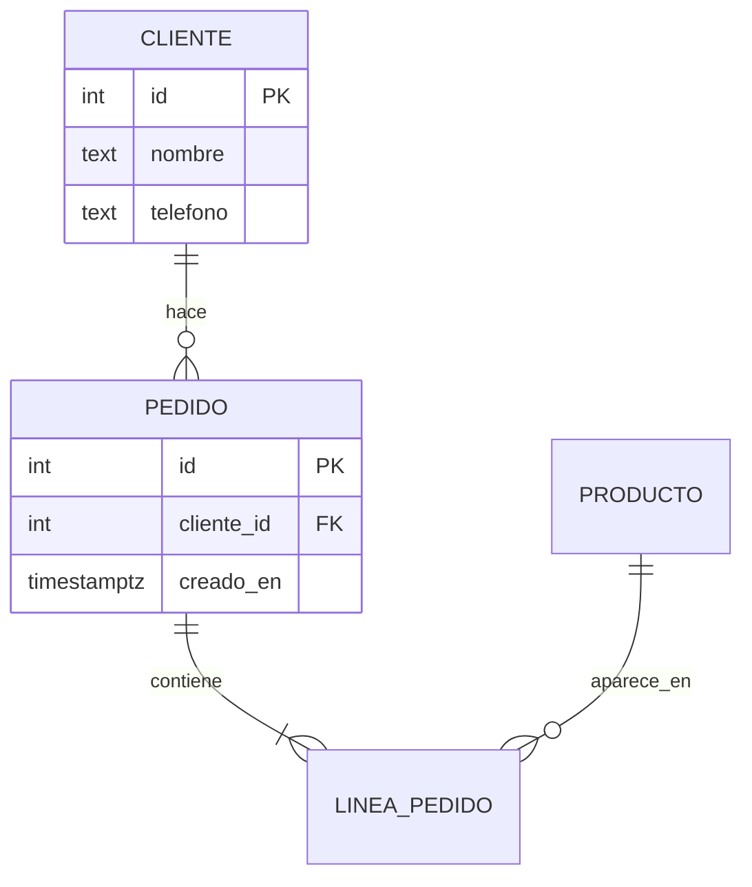

# PRD · <Nombre de tu producto>

> Documento de requisitos del producto (Product Requirements Document).
> Complétalo en el Sprint 0 (historia H0.3) y pide la aprobación del profesor en un Issue.
> Cada requisito funcional (RF) se convierte en un Issue con la plantilla "Historia de usuario".

| Campo | Valor |
| --- | --- |
| Alumno | klei |
| Proyecto n.º | 3  RepuestoMarket|
| Sitio de referencia | |
| Compañero revisor | Pendiente de confirmar |
| URL desplegada | (se completa en el Sprint 5) |

## 1. Problema

Las personas que necesitan comprar repuestos tienen dificultades para encontrar rápidamente la pieza adecuada entre diferentes opciones y publicaciones.

## 2. Usuarios

-Personas que necesitan buscar, consultar y comparar repuestos, así como vendedores que desean ofrecer sus productos.

## 3. Objetivo y métrica de éxito
* Encontrar repuestos relacionados con los términos ingresados.
* Permitir combinar varios filtros.
* Mostrar resultados relevantes y organizados.
* Facilitar la consulta de información de cada repuesto.

## 4. Alcance del MVP

Entre 5 y 8 funcionalidades que SÍ entran este semestre.

Alcance del MVP

Durante este semestre se desarrollarán las siguientes funcionalidades:

1. Registro de repuestos: permitir agregar repuestos con nombre, descripción, categoría y características.
2. Listado de repuestos: mostrar los repuestos disponibles en la plataforma.
3. Búsqueda por palabras clave: permitir encontrar repuestos escribiendo términos relacionados.
4. Índice invertido: implementar una estructura que facilite localizar repuestos mediante palabras clave.
5. Filtros combinados: permitir aplicar varios filtros para precisar los resultados.
6. Consulta de detalles: mostrar información específica de cada repuesto.
7. Ordenamiento de resultados: organizar los resultados para facilitar su consulta.

### Funcionalidades → carpetas de `src/` (screaming architecture)

Cada funcionalidad del alcance será una carpeta en `src/`. Nómbralas en inglés y en plural.

Funcionalidad           Nombre de carpeta
Registro de repuestos    spare-parts
Listado de repuestos       listings
Búsqueda por palabras clave searches
Índice invertido             indexes
Filtros combinados           filters
Consulta de detalles         details
Ordenamiento de resultados

## 5. Fuera de alcance

Lo que NO vas a construir.

-Funcionalidades fuera del alcance

Durante este semestre, RepuestoMarket no incluirá las siguientes funcionalidades:

1. Aplicación móvil para Android o iOS.
2. Procesamiento de pagos en línea.
3. Gestión de envíos y entregas a domicilio.
4. Chat en tiempo real entre compradores y vendedores.
5. Integración con servicios externos de facturación.
6. Sistema de recomendaciones automáticas mediante inteligencia artificial.

## 6. Requisitos funcionales

Requisitos funcionales

1. El sistema debe permitir registrar nuevos repuestos.
2. El sistema debe permitir visualizar el listado de repuestos disponibles.
3. El sistema debe permitir buscar repuestos mediante palabras clave.
4. El sistema debe utilizar un índice invertido para localizar información relacionada con la búsqueda.
5. El sistema debe permitir aplicar varios filtros simultáneamente.
6. El sistema debe mostrar los detalles de cada repuesto.
7. El sistema debe permitir ordenar los resultados de búsqueda.

## 7. Requisitos no funcionales

- Requisitos no funcionales

1. Rendimiento: las búsquedas deben ejecutarse de manera eficiente.
2. Usabilidad: la interfaz debe ser sencilla y fácil de utilizar.
3. Seguridad: el sistema debe proteger la información almacenada.
4. Mantenibilidad: el código debe estar organizado para facilitar futuras modificaciones.
5. Confiabilidad: el sistema debe responder correctamente ante las operaciones realizadas.
6. Escalabilidad: la estructura debe permitir incorporar más repuestos y funcionalidades en el futuro.

## 8. Modelo de datos

Diagrama entidad-relación y tablas PostgreSQL con tipos, claves y restricciones.
GitHub dibuja diagramas Mermaid; edita este ejemplo:

Diagrama entidad-relación

erDiagram
    VENDEDORES ||--o{ REPUESTOS : publica
    CATEGORIAS ||--o{ REPUESTOS : clasifica
    VENDEDORES {
        INTEGER id PK
        VARCHAR nombre
        VARCHAR correo UK
        TIMESTAMP creado_en
    }
    CATEGORIAS {
        INTEGER id PK
        VARCHAR nombre
        TEXT descripcion
    }
    REPUESTOS {
        INTEGER id PK
        INTEGER vendedor_id FK
        INTEGER categoria_id FK
        VARCHAR nombre
        TEXT descripcion
        NUMERIC precio
        INTEGER existencia
        TIMESTAMP creado_en
    }

Tablas de PostgreSQL

Tabla: vendedores

Campo	Tipo	Restricción
id	INTEGER	PRIMARY KEY
nombre	VARCHAR(100)	NOT NULL
correo	VARCHAR(150)	UNIQUE, NOT NULL
creado_en	TIMESTAMP	NOT NULL

Tabla: categorias

Campo	Tipo	Restricción
id	INTEGER	PRIMARY KEY
nombre	VARCHAR(100)	NOT NULL
descripcion	TEXT	Opcional

Tabla: repuestos

Campo	Tipo	Restricción
id	INTEGER	PRIMARY KEY
vendedor_id	INTEGER	FOREIGN KEY
categoria_id	INTEGER	FOREIGN KEY
nombre	VARCHAR(150)	NOT NULL
descripcion	TEXT	Opcional
precio	NUMERIC(10,2)	NOT NULL
existencia	INTEGER	NOT NULL
creado_en	TIMESTAMP	NOT NULL

Relaciones

* Un vendedor puede publicar muchos repuestos.
* Una categoría puede contener muchos repuestos.
* Cada repuesto pertenece a un vendedor y a una categoría.

Las claves foráneas permiten relacionar las tablas y mantener la integridad de los datos.

## 9. Reto técnico distintivo

El que te tocó en el catálogo y cómo piensas resolverlo.

Reto técnico distintivo

El principal reto técnico de RepuestoMarket será desarrollar un buscador eficiente utilizando un índice invertido, que permita localizar repuestos a partir de palabras clave.

El sistema deberá:

* Crear un índice invertido para relacionar palabras con los repuestos donde aparecen.
* Procesar las búsquedas realizadas por los usuarios.
* Combinar varios filtros, como categoría, precio y disponibilidad.
* Ordenar los resultados según su relevancia.
* Mantener actualizado el índice cuando se registren o modifiquen repuestos.

Este reto permitirá mejorar la velocidad y precisión de las búsquedas dentro del marketplace.

## 10. Riesgos y preguntas abiertas

-Riesgos

1. Rendimiento de búsqueda: el índice invertido podría tardar en actualizarse cuando se registren muchos repuestos.
    * Mitigación: optimizar las consultas y mantener actualizado el índice.
2. Datos incorrectos: los vendedores podrían registrar información incompleta o equivocada.
    * Mitigación: validar los datos antes de guardar cada repuesto.
3. Duplicación de repuestos: podrían registrarse varias veces productos iguales.
    * Mitigación: establecer validaciones para detectar posibles duplicados.
4. Seguridad: existe el riesgo de accesos no autorizados a la información.
    * Mitigación: implementar controles de acceso y validación de datos.
5. Crecimiento del sistema: el aumento de repuestos podría afectar el rendimiento.
    * Mitigación: diseñar una estructura de base de datos que permita optimizar las consultas.

    Preguntas abiertas

1. ¿Qué información adicional será necesaria para identificar correctamente cada repuesto?
2. ¿Cómo se verificarán los datos de los vendedores?
3. ¿Qué filtros serán prioritarios para los usuarios?
4. ¿Cómo se manejarán los repuestos que no tengan existencia?
5. ¿Qué estrategia se utilizará para mantener actualizado el índice invertido?
6. ¿Qué medidas de seguridad se aplicarán para proteger la información?

Estas preguntas se revisarán durante el desarrollo del proyecto y podrán actualizarse según las necesidades del sistema.
